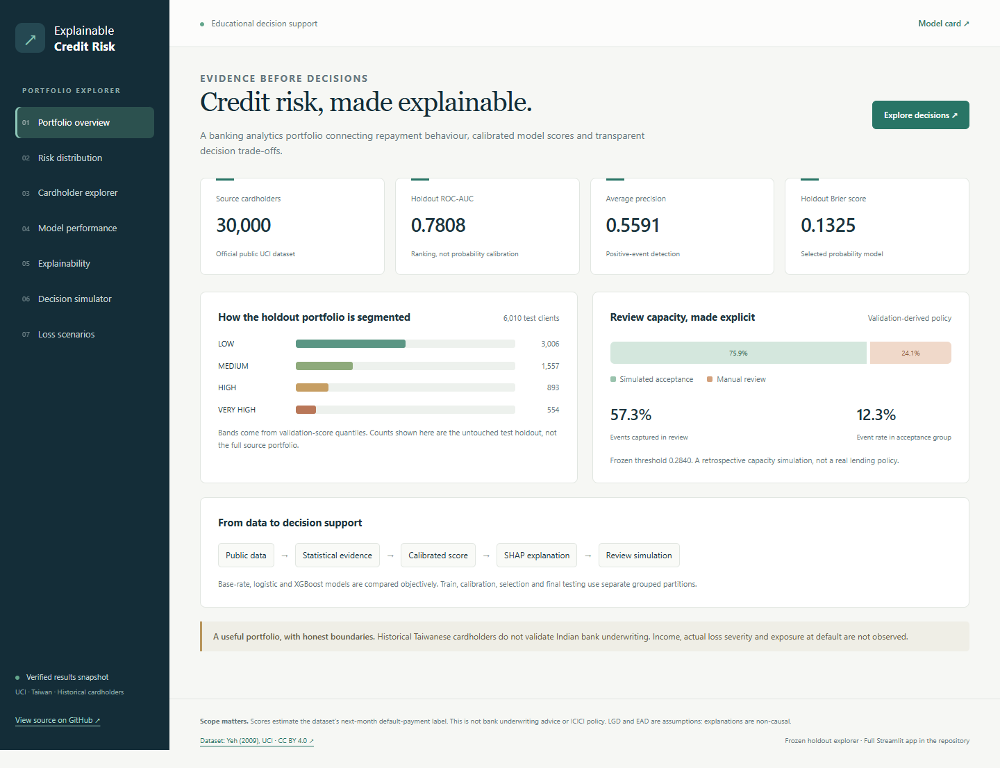
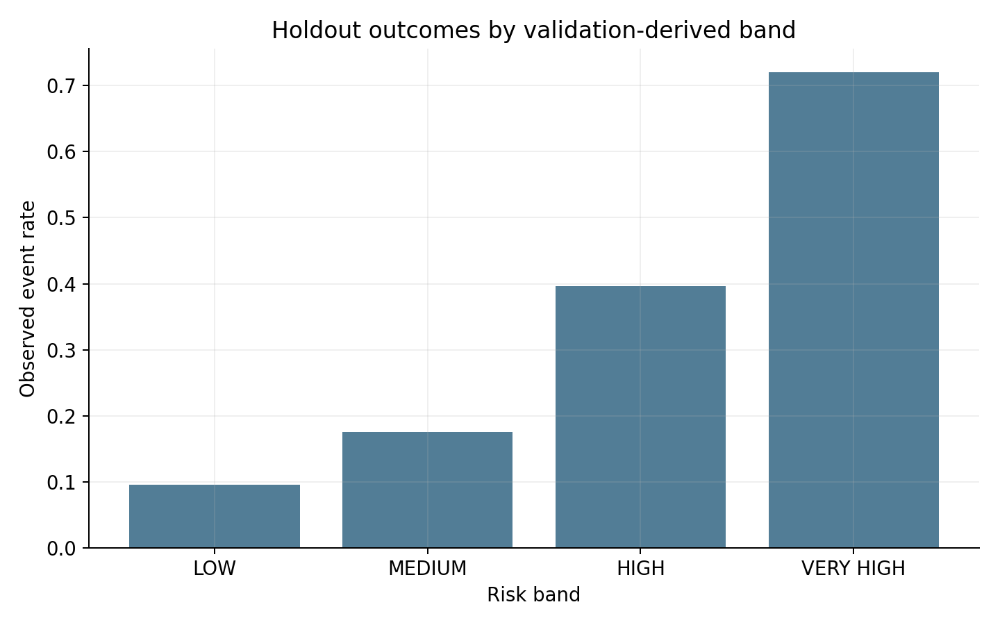
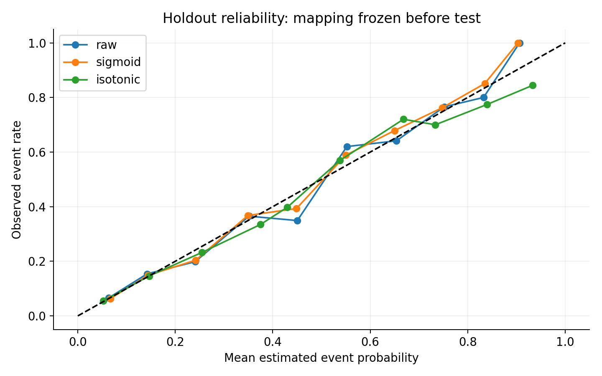
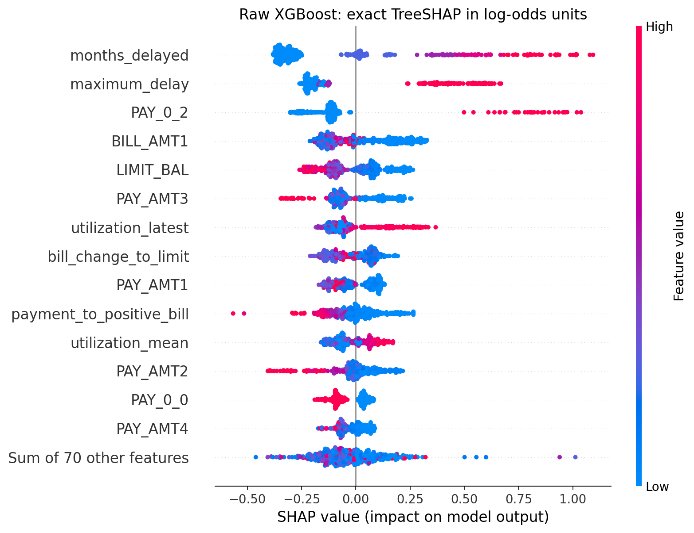

# Explainable Credit Risk

### Retail Credit Risk & Explainable Loan Decision Engine

**A reproducible banking analytics portfolio that turns repayment histories into explainable risk estimates and transparent review simulations.**

**Interactive demo:** prepared for GitHub Pages; publication is not yet verified. · [Model card](reports/model_card.md) · [Executive summary](reports/executive_summary.md) · [Technical methodology](docs/technical_methodology.md)

Python · scikit-learn · XGBoost · SHAP · DuckDB / SQL · Streamlit · pytest



> Educational decision support using historical public cardholder data. This project does not recommend ICICI lending policy. Its scores estimate the dataset's payment-event label, not bank-grade Indian loan PD.

## What this project demonstrates

- **Statistical judgment:** confidence intervals, distribution comparisons, effect sizes, multiplicity correction and exploratory logistic inference.
- **Honest model validation:** grouped partitions for training, calibration, selection and final testing; preprocessing learns only from training.
- **Probability quality:** separate ranking and calibration evaluation; raw, sigmoid and isotonic mappings are compared without test leakage.
- **Business reasoning:** review-capacity trade-offs, risk bands, explicitly assumed losses and responsible subgroup/monitoring analysis.
- **Usable evidence:** executed SQL, global/local SHAP, a Streamlit dashboard and a public results explorer.

## Verified results

| Evidence | Executed result |
| --- | --- |
| Source clients | 30,000 |
| Positive events | 6,636 (22.12%) |
| Final test clients | 6,010 |
| Selected model | Sigmoid-calibrated XGBoost |
| Test ROC-AUC / average precision | 0.7808 / 0.5591 |
| Test KS / Brier score | 0.4302 / 0.1325 |
| Review rate / event capture | 24.08% / 57.31% |
| Event rate in simulated acceptance group | 12.29% |

**Calibration nuance:** sigmoid calibration won on validation Brier. Raw XGBoost had a slightly better Brier on the final test holdout; this is disclosed rather than changing the selected model after seeing test results.

| Model / probability mapping | ROC-AUC | Average precision | Brier score |
| --- | --- | --- | --- |
| base_rate:raw | 0.5000 | 0.2186 | 0.1708 |
| logistic:raw | 0.7634 | 0.5373 | 0.1355 |
| xgboost:sigmoid | 0.7808 | 0.5591 | 0.1325 |

All empirical figures come from executed code. [Run summary](artifacts/tables/run_summary.json), [full model comparisons](artifacts/tables/test_models.csv), [threshold trade-offs](artifacts/tables/threshold_tradeoffs.csv) and [confidence intervals](artifacts/tables/test_confidence_intervals.csv) provide traceability. Review figures are retrospective simulations, not actual approvals or profit improvements.

## Explore the evidence



<details>
<summary><strong>View probability calibration and SHAP explanations</strong></summary>





SHAP explains the raw tree's log-odds, not calibrated probabilities or causal effects. The saved app includes local contributions for every test cardholder.

</details>

## Dashboard

The **public demo** is a browser-based explorer of frozen verified results: portfolio overview, risk distribution, cardholder scores, model performance, SHAP explanations, review-threshold simulation and assumed-loss scenarios. It performs no new model inference or retraining. Its predictions are exported by `python -m src.web_demo` from the same artifacts used by Streamlit.

The **full Streamlit application** is included in [app/app.py](app/app.py). Run it locally after generating the artifacts. It also loads saved results instead of retraining at startup. [Dashboard and hosting guide](docs/dashboard.md).

## Reproduce the project

Clone the repository and run commands from its root. Python **3.12** is the verified runtime.

```bash
git clone https://github.com/akashsmb10/explainable-credit-risk.git
cd explainable-credit-risk
```

<details open>
<summary><strong>Windows PowerShell</strong></summary>

```powershell
py -3.12 -m venv .venv
.\.venv\Scripts\python.exe -m pip install -r requirements-lock.txt
.\.venv\Scripts\python.exe -m src.pipeline --clean
.\.venv\Scripts\python.exe -m src.notebooks
.\.venv\Scripts\python.exe -m src.final_audit
.\.venv\Scripts\python.exe -m src.web_demo
.\.venv\Scripts\python.exe -m streamlit run app/app.py
```

</details>

<details>
<summary><strong>Linux / macOS</strong></summary>

```bash
python3.12 -m venv .venv
.venv/bin/python -m pip install -r requirements-lock.txt
.venv/bin/python -m src.pipeline --clean
.venv/bin/python -m src.notebooks
.venv/bin/python -m src.final_audit
.venv/bin/python -m src.web_demo
.venv/bin/python -m streamlit run app/app.py
```

Cross-platform execution is checked by GitHub Actions when available; the local verified environment is Windows. The first pipeline run downloads the official UCI archive. `--clean` regenerates only downstream output directories and retains downloaded source data. Model training is required before using Streamlit on a fresh clone. Raw data, serialized models, full prediction dumps and the virtual environment are deliberately excluded from Git.

</details>

The final audit runs pytest, replays saved predictions, reruns every SQL query, checks notebook execution and starts a temporary Streamlit HTTP server. [Final execution audit](reports/final_audit.md).

## Repository map

```text
app/                     Streamlit dashboard
config/                  Reproducible settings and scenario assumptions
docs/                    Data dictionary, scope, methodology and dashboard guide
notebooks/               Executed audit-to-decision narrative
src/                     Reusable Python pipeline and artifact exporters
sql/                     Executed DuckDB analytical queries
tests/                   Feature, leakage, decision and dashboard tests
artifacts/figures/       Generated analytical figures
artifacts/tables/        Shareable evidence and execution summaries
reports/                 Model card, findings, interview preparation and audit
site/                    Static interactive public demo and saved result snapshot
scripts/                 Repository publication and presentation checks
```

## Dataset, assumptions and limitations

[UCI Default of Credit Card Clients](https://archive.ics.uci.edu/dataset/350/default+of+credit+card+clients), Yeh (2009), [DOI: 10.24432/C55S3H](https://doi.org/10.24432/C55S3H). Historical Taiwanese existing cardholders; next-month default-payment target. Income, actual LGD/EAD, recoveries, rejected applicants and separate temporal cohorts are unavailable.

Risk-band thresholds express a validation-derived review-capacity scenario. LGD and EAD are explicitly assumed in loss sensitivity analysis; credit limit is not measured EAD. Demographics are excluded from scoring, but subgroup differences and proxy risks remain. No actual production or temporal drift evidence is claimed. Statistical associations and SHAP are non-causal. See [model scope](docs/model_scope_and_limitations.md), [statistical findings](reports/statistical_findings.md) and [model card](reports/model_card.md).

## Documentation worth reading

| Document | Purpose |
| --- | --- |
| [Executive summary](reports/executive_summary.md) | Business problem, measured results and boundaries |
| [Technical methodology](docs/technical_methodology.md) | Complete modeling, calibration and statistical rationale |
| [Data dictionary](docs/data_dictionary.md) | Source schema, code issues and audit findings |
| [Model card](reports/model_card.md) | Intended use, validation, fairness and monitoring limitations |
| [Interview guide](reports/interview_guide.md) | Questions, concise answers and deeper technical follow-ups |
| [Verified resume bullets](reports/resume_bullets.md) | Three concise claims linked to executed evidence |
| [Final audit](reports/final_audit.md) | Reproduction and verification results |
| [Publication checks](reports/publication_audit.md) | Exported-score consistency, links and upload hygiene |

## Attribution and license

Project code is [MIT licensed](LICENSE). The UCI dataset is **CC BY 4.0**; its source and attribution are preserved in [NOTICE](NOTICE). The live snapshot contains public benchmark observations and model-derived results, not private bank customer data.
